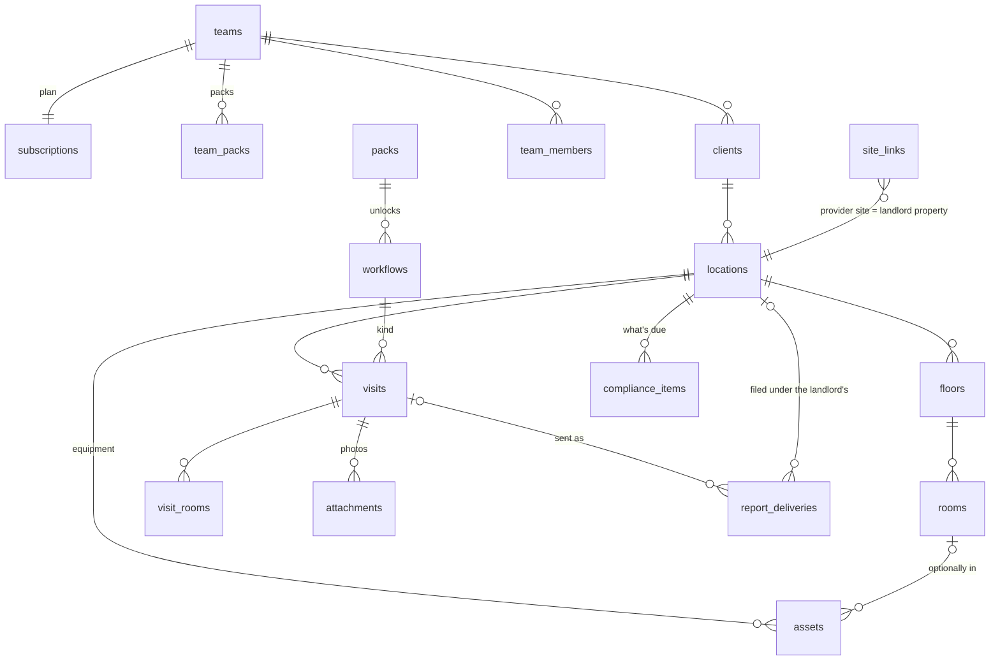

# Pemcora editions — data model

**Status: draft for review.** Nothing here has been applied to Supabase. The two
migrations in this folder have been run on a local Postgres on top of the real
0001–0005, twice each, and pass 183 checks (`test/`).

They live in `docs/editions/`, not `supabase/migrations/`, on purpose: the folder
is linked to the Supabase CLI, and `supabase db push` would apply anything placed
there. Move them across once reviewed.

**Build plan.** `build-plan.md` in this folder is the plan Claude Code works from. It
changes parts of this design (its Phase A); where the two differ, the build plan wins.

---

## The idea

One app, one Supabase project, sold as **editions**.

- A **team** is an organisation, and it is one of three kinds:
  **provider** (does inspections — an AV integrator, an electrician),
  **landlord** or **agency** (receives reports).
- A provider unlocks **workflows** through **packs**. A workflow is exactly what
  `visits.kind` already is — `maintenance`, `commissioning`, `custom` — so today's
  three become the first rows of a catalogue instead of a hard-coded list.
- The tree you already have carries every trade without changing shape:

  | Pemcora today | AV room job | Rental house |
  |---|---|---|
  | client | Acme Corp | Jane (the landlord) or the agency |
  | location | 1 George St | 10 Smith St, Richmond |
  | floor | Level 3 | Ground, Upstairs |
  | room | Boardroom 3.01 | Bedroom 1, Hallway, Meter box |
  | visit | PM visit | Electrical safety check |
  | visit_room | the room's results | the room's results |

- Three new things sit beside the tree: **assets** (the equipment), **compliance
  items** (what each site owes and when it is next due), and **report deliveries**
  (the only thing that ever crosses from a provider to a landlord).



---

## Features → where they live

| Feature | Pack / workflow | Tables it uses |
|---|---|---|
| **#6 AV maintenance** (today) | `av`: `maintenance`, `commissioning` | unchanged; optional `compliance_items` for contract cadence (e.g. quarterly PM) |
| **#1 VIC rental safety checks** | `vic_rental`: `vic_electrical_safety` (every 24 months), `vic_smoke_alarm` (every 12) | `visits.site_results` (switchboard, RCDs), `visit_rooms.readings` (measured values), `assets` (RCDs, alarms), `compliance_items` (re-check list), `report_deliveries` |
| **#2 QLD electrical and smoke alarms** | `qld_electrical`: `qld_smoke_alarm` (every 12, fixed), `qld_electrical_safety` (every 24, adjustable) | `rooms.room_type` (every bedroom/hallway covered?), `assets.expires_on` (10-year replacement), `compliance_items` |
| **Electrical baseline** (states without their own pack) | `electrical_general`: `electrical_safety` (every 24, adjustable), `smoke_alarm_check` (every 12, adjustable) | as VIC |
| **#3 Landlord side** | none — landlords and agencies don't inspect | `teams.account_type`, `report_deliveries`, `site_links`, their own `locations` + `compliance_items` as the tracker |
| **Free vs Pro** | — | `subscriptions`, `team_packs`, `team_usage`, `app_settings` |
| **Custom lists** | `core`, which every team has | unchanged |

---

## What changes on existing tables

All additive, all with defaults, so every existing row reads exactly as before.

| Table | New | Why |
|---|---|---|
| `teams` | `account_type` provider · landlord · agency | which side of a delivery a team is on. Column-locked: the app can still rename and describe a team and nothing else |
| `visits.kind`, `team_templates.kind` | CHECK list → foreign key to `workflows` | the next state's rules is one INSERT, not an ALTER |
| `teams` | `import_open_until`, `import_used_at` | the owner's one-time window for importing older work |
| `team_invites` | `invitee_name`, `cancelled_at`, `cancel_reason` | the notice can name who lost the last seat |
| `clients` | `contact_name`, `contact_email`, `contact_phone`, `reminders_enabled` | who gets the report and the re-check reminder, and whether they get reminders |
| `team_settings` | `reminders_enabled` | reminders off for the whole team (admins) |
| `member_prefs` | `licence_number` | each technician's licence, printed on reports |
| `locations` | `site_type` commercial · residential, `is_rental` | which rules apply |
| `rooms` | `room_type` (`bedroom`, `hallway`, `meter_box`, …) | switch on the right sections; check alarm coverage |
| `visits` | `site_results`, `outcome` compliant · non_compliant, `signoff` | once-per-visit sections; the certificate's verdict, declared at sign-off; who signed, their licence and signature, kept with the visit |
| `visit_rooms` | `readings` | measured values beside PASS/FAIL, keyed like `results` |

**Where results live** (no column changes, all jsonb): an ordinary section is
`results[sectionId][testId]`; a section repeated for each item (each RCD, each
smoke alarm) is `results[sectionId][assetId][testId]`, in `visit_rooms` for a
room and in `visits.site_results` for the whole site. Readings follow the same
paths as `{ value, unit }`. The template snapshot records each section's scope,
so a reader knows which shape it is.

## New tables

**0006 — editions and billing**

| Table | Holds | Who writes |
|---|---|---|
| `packs` | `core`, `av`, `vic_rental`, `qld_electrical`, `electrical_general` | migration only |
| `workflows` | each workflow, its pack, its recurrence in months | migration only |
| `subscriptions` | one per team: plan, status, seats, monthly allowance, Stripe ids | Stripe webhook (service role) only |
| `team_packs` | which packs a team has: one `starter`, plus `addon` / `comped` | `choose_starter_pack()`, webhook |
| `team_usage` | inspections started per month (a counter: deleting visits doesn't refund) | trigger |
| `app_settings` | one switch: `enforce_limits` | you, in the SQL editor |
| `team_notices` | things owners and admins need to be told, such as an invitation cancelled because the seats ran out | functions and the webhook only; admins mark them read |

**0007 — field data and delivery**

| Table | Holds |
|---|---|
| `assets` | equipment at a site, optionally in a room. `attributes` jsonb for pack fields (alarm sensor, power source, interconnected…). Removed, never deleted. `expiry_reminded_at` for the reminder job |
| `compliance_items` | one row per site per obligation: interval, last done, next due, reminder lead time, reminder switch and opt-out token. Provider side = re-check pipeline; landlord side = tracker (incl. hand-entered ones like a gas check, whose next due date the database works out) |
| `workflow_intervals` | a team's chosen interval for a workflow it may set: one team default, plus per-client overrides. Written only by `set_workflow_interval()` |
| `attachments` | photo evidence against a test (Pro) |
| `report_deliveries` | a sent report: frozen snapshot (with the sign-off), file, recipient email, link token and its 90-day expiry, where it was filed |
| `site_links` | "provider's site X is landlord's property Y", so later reports file themselves |

Storage: two private buckets, one folder per team — `evidence/<team_id>/…` and
`reports/<team_id>/…`. Delivered report files cannot be overwritten or deleted.

---

## Rules the database enforces

The limits **ship switched off**. They count and report but refuse nothing until
the day billing goes live:

```sql
update public.app_settings set enforce_limits = true;
```

Until then nobody can pay, and `tests/rls.mjs` joins a second person to a
brand-new team — both would hit a one-seat Free plan.

Visit dates are the exception: they are checked from the start. Whenever a
visit's start or completion date is written — on insert, or changed later — it
must be within the last 7 days (and no more than an hour ahead), and visits are
counted in the server's month, not the device's. Older work comes
in once, through the owner's 15-minute import window (`open_import_window()`).

| | Free | Pro | Enforced by |
|---|---|---|---|
| Seats | 1 | `subscriptions.seats` (empty = unlimited) | triggers on `team_members` and `team_invites` (invites count, so nobody confirms into a full team) |
| Inspections a month | 1 (`subscriptions.monthly_visit_limit`) | unlimited | trigger on `visits` insert |
| Packs | one starter (swappable until there's work under it) | starter + paid add-ons | trigger on `visits` insert |
| Photo evidence | — | ✓ | trigger on `attachments` + storage policy |
| Send reports to landlords | ✓ | ✓ | — this is the growth loop, so it stays free |
| Branding on reports | soft (UI only) | ✓ | hard only once PDFs are generated server-side |

Limit errors come back as **HTTP 402** (SQLSTATE `PT402`) with hint `upgrade`, so
the app can show an upgrade prompt instead of a generic error.

**Existing teams are grandfathered**: Pro, unlimited, AV pack, `comped = true`.
Re-running 0006 can never comp a team created after the first run.

**Why in the database and not the UI:** Pemcora is a static site with the
publishable key in the bundle. Anything React hides, the REST API still answers.

## Functions the app calls

| RPC | Who | Does |
|---|---|---|
| `create_organisation(name, account_type, pack_id)` | anyone signed in | the new onboarding; wraps `create_team()` |
| `choose_starter_pack(team, pack)` | owner/admin | pick or swap the starter |
| `team_entitlements(team)` | members | plan, limits, usage, packs, `enforced` — for upgrade prompts and nav |
| `open_import_window(team)` | owner | opens the one-time, 15-minute window for importing older work |
| `send_report(visit, email, snapshot, file_path)` | provider members | records a delivery; address, provider name and sign-off come from the DB, not the client |
| `report_preview(token)` | anyone with the link | `status` ok · expired · saved; content only while ok, else just the provider's name |
| `resend_report(delivery)` | provider members | "Send again": a new token and 90 days; the old link stops working |
| `claim_report(token, team)` | the addressee only | saves into their landlord/agency team; auto-files when the address matches; works after the link expires |
| `file_report(delivery, location)` | recipient members | files an unfiled report under a property |
| `revoke_report(delivery)` | provider members | withdraws a report until it's claimed |
| `due_list(team, within_days, expiry_months)` | members | the Due page: overdue, due soon, "not done yet" sites on a regular interval, and alarms expiring |
| `set_workflow_interval(team, workflow, client, months)` | owner/admin | regular intervals (team default or per client); refuses intervals fixed by law; recalculates due dates |
| `reminder_opt_out(token)` | anyone with the link | a reminder's "No longer needed": switches that check's reminders off and tells the provider |

Today's `create_team()` keeps working untouched: a team made that way gets Free
with AV as its starter, which is what today's AV-only screens expect.

---

## What the app needs (for Claude Code)

Superseded by `build-plan.md`, which replaces this list. Kept for reference.

Roughly in build order. Each item is small because the shapes above already exist.

1. **Pack definitions in code.** Split `src/data/testLists.js` into
   `src/data/packs/{av,vic_rental,qld_electrical}.js`. Each exports its workflows,
   their page config (like `PreventativeMaintenance.jsx`), and template seeds.
   `templateStore.seed(kind)` looks the kind up instead of the current if/else.
   Test lists stay in code — never in SQL (see the note in 0001).
2. **Template schema, backward compatible.** Existing tests have no `type` and keep
   working as PASS/FAIL/N/A.
   - `test.type`: `check` (default) · `measure` `{unit, min, max}` · `choice` `{options}` · `text`
   - `section.scope`: `room` (default) · `site` → stored in `visits.site_results`
   - `section.roomTypes`: e.g. `['bedroom','hallway']` → section auto-enabled in those rooms
3. **Onboarding.** Team Setup calls `create_organisation()` and asks two things:
   what do you do (AV integrator · Electrician · Landlord · Property manager) and
   which state.
4. **Nav from packs.** Give each `nav.js` entry a `pack`; `SideNav` filters by
   `team_entitlements().packs`. Landlord/agency teams get a different nav
   (Properties, Reports, Due).
5. **WorkflowPage.** A "Whole site" step for `scope: 'site'` sections; reading
   inputs for `measure` tests; an outcome declaration at sign-off.
6. **Equipment** panel per location (`assets`), with the pack's alarm fields.
7. **Due** page: `compliance_items` due in the next N days, overdue first.
8. **Send report.** Generate a PDF in the browser (the .xlsx exporter stays),
   upload to `reports/<team_id>/<uuid>.pdf`, call a `deliver-report` Edge
   Function modelled on `send-invite` → `send_report()` → Resend email with
   `#/r/<token>`.
9. **Landlord side.** The `#/r/<token>` page (`report_preview()`; a small Edge
   Function makes the signed file URL for people not signed in), sign-up and
   `claim_report()`, a properties list with each property's compliance items.
10. **Upgrade prompts.** Read `team_entitlements()` on load; treat any 402 as
    "show the upgrade sheet".
11. **Billing.** Stripe Checkout + a webhook Edge Function (service role) writing
    `subscriptions` and add-on `team_packs`. Until it exists, upgrade a team by
    hand:
    ```sql
    update public.subscriptions set plan = 'pro', seats = 3 where team_id = '…';
    ```
12. **Reminders.** A daily scheduled Edge Function: Pro providers' items due within
    `remind_days_before`, emailed to the client contact with a "book your re-check"
    link; set `last_reminded_at`.
13. **Tests.** Extend `tests/rls.mjs` with the cross-team boundaries;
    `docs/editions/test/` has the SQL-level suite to keep green.

If you want a shot at Queensland's 1 January 2027 deadline, build `qld_electrical`'s
smoke alarm check first: it needs no measurement fields, so steps 2 (`measure`), 5 (readings) and
the site step can wait. Treat it as a bonus — annual testing carries on after.

## Rollout

1. Run **0006** in the SQL editor → nothing visible changes. Check the second
   result: your team should read `pro · comped · av`.
2. Run **0007** → nothing visible changes for AV.
3. Build steps 1–8 → electricians can work and send reports (limits still off).
4. Build step 9 → landlords can receive and track.
5. Build steps 10–12, then flip `enforce_limits` on.

## Decisions for you

- **Free allowance:** 1 inspection a month (the `monthly_visit_limit` default).
- **Pricing** of Pro per seat and of add-on packs.
- **Landlords' free tier:** receiving and storing reports is free; uploading their
  own certificates (e.g. a gas check) is currently Pro.
- **Time zone:** due dates and months are reckoned in Sydney time (`local_day()`),
  fine for the east coast; per-team zones later if you go national.

## Known limits of this draft

- One recipient per report. Forwarding (agency → owner) isn't modelled yet.
- A device offline for more than 7 days can't save the visits it started: dates older than that are refused outside the owner's one-time import window.
- Reopening a completed visit doesn't roll back a due date.
- Branding is only a soft gate while reports are generated in the browser.
